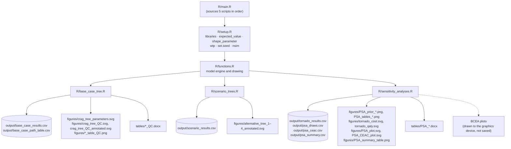
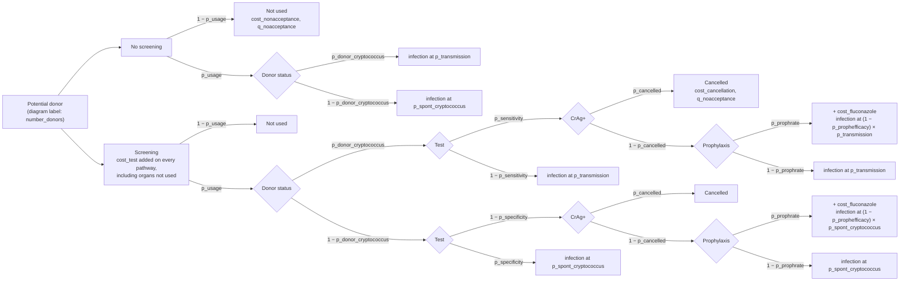
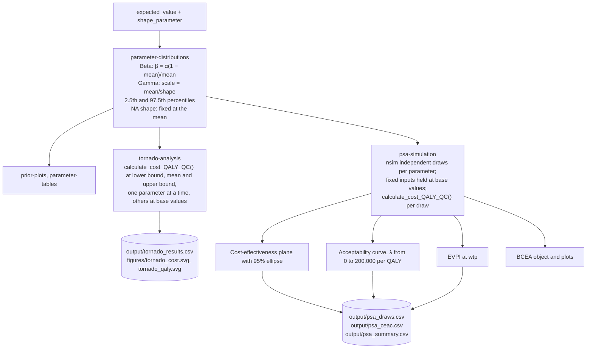
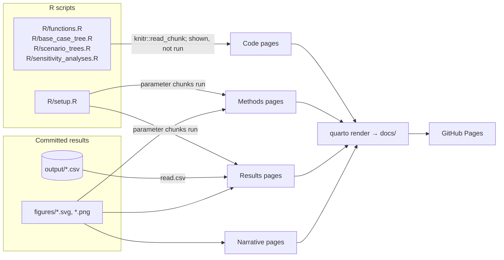

# Architecture

This document describes how the Cryptococcus donor screening cost-effectiveness analysis is organized: the R pipeline that builds the decision tree and runs the sensitivity analyses, and the Quarto website that presents the results. It is written for people reading or modifying the code and for AI agents working in the repository.

> **Code state.** Written against commit `17a01ff` on `master` (25 October 2026). File paths and symbol names are stable references; check the source for current details.

## Overview

The project is a two-strategy decision tree comparing donor serum cryptococcal antigen (CrAg) screening with no screening in US deceased-donor kidney transplantation. It reports incremental cost (ΔC), incremental QALYs (ΔQ) and net monetary benefit (NMB) at a willingness-to-pay threshold.

It has two layers:

1. **An R script pipeline** (`R/`), run from `R/main.R`, which computes the base case, the scenario analyses, the one-way (tornado) sensitivity analysis and the probabilistic sensitivity analysis (PSA). It writes CSVs to `output/`, figures to `figures/` and Word tables to `tables/`.
2. **A Quarto website** (`_quarto.yml`, `index.qmd`, `quarto/`), rendered to `docs/` and served by GitHub Pages. The site **does not run the model**. It displays code by reading labelled chunks from the R scripts, evaluates only the parameter chunks of `R/setup.R`, and reads results from the committed files in `output/` and `figures/`.

This is an analysis project, not an R package.

## Pipeline

All scripts run in one shared global environment. Functions in `R/functions.R` take their default parameter values from `expected_value` and read `wtp` from the global environment, so `R/setup.R` must be sourced first. Run the pipeline from the project root, because every path is relative to it.

## Components

### Setup

**Location**: `R/setup.R`

**Purpose**: Loads packages and defines every model input.

**Key objects** (chunk labels in parentheses):
- `libraries` — DiagrammeR, DiagrammeRsvg, glue, tibble, gt, tidyverse, ggtext, xml2, BCEA, ellipse, svglite, webshot2. Saving `.png` tables with `gtsave()` needs a Chrome or Chromium installation.
- `expected_value` (`expected-values`) — the base-case value of each parameter.
- `shape_parameter` (`shape-parameters`) — the Beta α for probabilities and the gamma shape k for costs and QALYs. `NA` means the input is fixed in the sensitivity analyses.
- `wtp`, `set.seed()`, `nsim` (`simulation-settings`) — the willingness-to-pay threshold, the random seed and the number of PSA draws.

### Model engine

**Location**: `R/functions.R`

| Symbol | Chunk label | Purpose | Called by |
|---|---|---|---|
| `calculate_cost_QALY_QC()` | `calculate-cost-qaly` | Derives complementary probabilities, builds the pathway table, and returns one row of expected cost and QALYs per strategy (`total_expected_cost_ns`, `_s`, `total_expected_qaly_ns`, `_s`) | Tornado and PSA |
| `plot_tree_diagram_QC()` | `plot-tree-diagram` | Builds the GraphViz (DOT) tree with `DiagrammeR::grViz()`. Presentation only; accepts numbers or text labels | `create_tree_diagram_QC()`, the parameter-labelled tree |
| `create_tree_diagram_QC()` | `create-tree-diagram` | Builds the pathway table, the summary by strategy, a parameter table, ΔC, ΔQ, NMB and the tree plot for one parameter set | Base case, scenarios |
| `add_svg_annotation()` | `add-svg-annotation` | Writes the ΔC, ΔQ and NMB text block onto an exported tree SVG | Base case, scenarios |

**Two copies of the pathway table.** `calculate_cost_QALY_QC()` and `create_tree_diagram_QC()` each define the same 19-row pathway table. The base case and scenarios use one copy; the tornado and PSA use the other. Any structural change must be made in both.

**How ΔC and ΔQ are taken.** `create_tree_diagram_QC()` takes screening minus no screening by row position in its summary, which relies on `group_by(strategy)` ordering "No Screening" before "Screening". `calculate_cost_QALY_QC()` returns named columns, and its callers subtract `_s − _ns`.

### Decision tree

The tree has 19 terminal pathways: 5 under no screening and 14 under screening.

Each "infection at …" leaf splits into two terminal pathways:

- **Recipient cryptococcosis**: cost `cost_disease`, QALYs `q_nocryptococcus − q_loss_cryptococcus`.
- **No cryptococcosis**: cost `cost_nocryptococcus`, QALYs `q_nocryptococcus`.

Probabilities start at the potential donor, and the test cost is charged even when organs are not used, so results are per potential donor. `number_donors` labels the root node of the diagram and does not enter the calculation.

### Base case

**Location**: `R/base_case_tree.R`

**Chunks**: `source-helpers`, `parameter-labelled-tree`, `base-case-tree`, `path-table`, `parameter-table`, `summary-table`.

Draws the tree labelled with parameter names and formulas, runs `create_tree_diagram_QC()` at the base-case values, saves the annotated tree, and formats the pathway, parameter and summary tables with gt. It writes `output/base_case_path_table.csv` and `output/base_case_results.csv`.

### Scenario analyses

**Location**: `R/scenario_trees.R`

**Chunks**: `scenario-1-low-cancellation`, `scenario-2-low-cancellation-high-prophylaxis`, `scenario-3-high-disease-cost`, `scenario-4-combined`.

Each scenario calls `create_tree_diagram_QC()` with one or more parameters overridden, then saves an annotated tree SVG. The four results are collected into `output/scenario_results.csv`.

### Sensitivity analyses

**Location**: `R/sensitivity_analyses.R`

**Chunks**: `source-helpers`, `parameter-distributions`, `prior-plots`, `parameter-tables`, `tornado-analysis`, `psa-simulation`, `ceac-bcea`.

The acceptability curve, EVPI, cost-effectiveness plane and summary table are all computed from the same set of PSA draws. Parameters are drawn independently; no correlation between inputs is modeled.

## Website

### Page types

| Type | Pages | How content gets there |
|---|---|---|
| Narrative | `index.qmd`, `quarto/background.qmd`, `quarto/cea_primer.qmd`, `quarto/about.qmd`, `references/literature-review.md` | Written text and embedded figures. `cea_primer.qmd` draws one explanatory figure when rendered |
| Methods | `quarto/model_structure.qmd`, `quarto/model_inputs.qmd`, `quarto/uncertainty_methods.qmd` | Run the `R/setup.R` parameter chunks for inline values; `model_inputs.qmd` computes prior intervals itself |
| Code | `quarto/setup.qmd`, `quarto/functions.qmd`, `quarto/base_case_tree.qmd`, `quarto/scenario_trees.qmd`, `quarto/sensitivity_analyses.qmd` | `knitr::read_chunk()` on the matching R script; chunks shown with `eval: false` inside the `.Rcode` callout. `setup.qmd` also runs the parameter chunks and builds a parameter summary table |
| Results | `quarto/results_base_case.qmd`, `quarto/results_scenarios.qmd`, `quarto/results_tornado.qmd`, `quarto/results_psa.qmd` | Read `output/*.csv` for inline numbers, embed `figures/`, and run the `R/setup.R` chunks for `expected_value`, `wtp` and `nsim` |

### Chunk-label contract

Lines of the form `## ---- label` in the R scripts mark the chunks that `knitr::read_chunk()` exposes to Quarto. A code page refers to these labels by name. If a label is renamed or removed in an R script without the matching change in the `.qmd` file, that section of the page renders empty.

### Keeping the site current

Rendering the site does not rerun the analysis. Values that come from `R/setup.R` update at render time; tables, figures and results from `output/` and `figures/` update only when `R/main.R` is rerun. After any change to `R/`, rerun `R/main.R` before rendering, or the methods pages and the results pages can disagree.

### Configuration

`_quarto.yml` sets:

- the render list (`index.qmd`, `quarto/*.qmd`, `references/literature-review.md`) and `output-dir: docs`
- the docked sidebar, in the order Home, Background, Methods, Setup and helper functions, Model code, Results, About
- the bibliography, `references.bib`
- the `custom-callout` filter (`_extensions/coatless-quarto/custom-callout/`), which defines the `.Rcode` callout used on the code pages
- HTML options: cosmo theme, table of contents, folded code, lightbox

There is no `freeze` setting.

The results pages carry `aliases`, so the earlier URLs (`base_case.html`, `additional_trees.html`, `tornado.html`, `psa.html`) redirect to `results_base_case.html`, `results_scenarios.html`, `results_tornado.html` and `results_psa.html`.

### README

`README.Rmd` renders to `README.md` (`github_document`). It is a short summary that embeds the same figures as the site, written separately from the site's text.

## Running and rendering

1. From the project root, source `R/main.R`. This regenerates `output/`, `figures/` and `tables/`.
2. Render the site with `quarto render`, which writes `docs/`.
3. Render `README.Rmd` to update `README.md`.
4. Commit `output/`, `figures/`, `tables/` and `docs/` together, so the published site matches the code.

The PSA is reproducible only when `R/main.R` runs in full. The seed is set once in `R/setup.R`, and `R/sensitivity_analyses.R` consumes random numbers to compute the distribution means before it draws the PSA samples. Sourcing `R/sensitivity_analyses.R` on its own produces a different set of draws.

## Code references

| Component | File | Key symbols |
|---|---|---|
| Entry point | `R/main.R` | sources the five scripts in order |
| Inputs | `R/setup.R` | `expected_value`, `shape_parameter`, `wtp`, `nsim` |
| Model engine | `R/functions.R` | `calculate_cost_QALY_QC()`, `create_tree_diagram_QC()` |
| Tree drawing | `R/functions.R` | `plot_tree_diagram_QC()`, `add_svg_annotation()` |
| Base case | `R/base_case_tree.R` | `g_QC`, `result_tibble_QC`, `summary_tibble_QC` |
| Scenarios | `R/scenario_trees.R` | `alternative_tree_1` to `alternative_tree_4`, `scenario_results` |
| Tornado | `R/sensitivity_analyses.R` | `PSA_parameters`, `tornado_parameters`, `tornado_parameters_final` |
| PSA | `R/sensitivity_analyses.R` | `PSA_simulation_unnested`, `ceac_df`, `evpi_at_wtp`, `PSA_summary_df`, `bcea_object` |
| Site configuration | `_quarto.yml` | `project.render`, `website.sidebar`, `custom-callout` |
| Open work | `TODO.md` | pending analysis decisions and model changes |
| Evidence | `references/literature-review.md`, `references.bib` | evidence for each parameter |

## Glossary

| Term | Definition |
|---|---|
| CrAg | Cryptococcal antigen; the donor serum test being evaluated |
| ΔC, ΔQ | Expected cost and QALYs under screening minus no screening, per potential donor |
| NMB | Net monetary benefit: `wtp × ΔQ − ΔC`. Screening is favored when NMB is positive |
| `_ns`, `_s` | Suffixes for the no-screening and screening strategies |
| Pathway table | One row per terminal pathway, with its probability, cost and QALYs |
| Fixed input | An input with `NA` shape, held at its base value in the sensitivity analyses |
| CEAC | Cost-effectiveness acceptability curve: the share of PSA draws with positive NMB at each threshold |
| EVPI | Expected value of perfect information at `wtp` |
