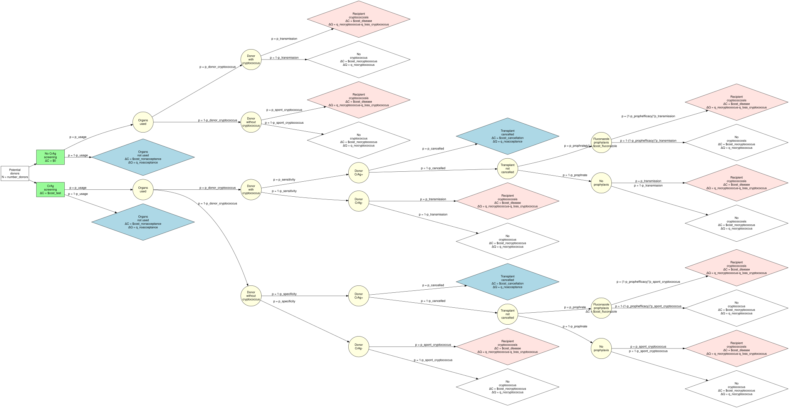

```{r}
#| label: read-setup
#| include: false
#| cache: false
knitr::read_chunk("../R/setup.R")
```

```{r}
#| label: expected-values
#| include: false
```

```{r}
#| label: simulation-settings
#| include: false
```

```{r}
#| label: value-helpers
#| include: false
v <- function(name) format(expected_value[[name]], big.mark = ",", scientific = FALSE)
dollars <- function(name) {
  x <- expected_value[[name]]
  paste0(if (x < 0) "\u2212" else "", "$", format(abs(x), big.mark = ",", scientific = FALSE))
}
```

::: callout-note
## Model version

This page describes the model as implemented in [`R/functions.R`](https://github.com/VagishHemmige/Cryptococcus-donor-screening-CEA/blob/master/R/functions.R) and [`R/setup.R`](https://github.com/VagishHemmige/Cryptococcus-donor-screening-CEA/blob/master/R/setup.R) in October 2026. Several structural choices are under review, and are listed under [Known limitations](#known-limitations). The numbers quoted on this page are read from `R/setup.R` when the page is rendered.
:::

If you have not worked with cost-effectiveness analysis before, the [primer](cea_primer.qmd) explains the terms used here.

## What is a decision tree?

A decision tree is a structured “if-this-then-that” map that compares two strategies (in this case, screen donors vs don’t screen) by averaging what would happen across many similar donors/recipients, weighting each possible outcome by its probability, and then adding up the costs and QALYs along the way.

## Conceptual decision tree

First, we sketch out a decision tree that reflects our conceptual understanding of how costs and QALYs are generated by the two strategies.  **Note:** Click to
enlarge the diagram below:

{
  fig-cap="Decision tree"
  .lightbox
}

At the far left, we have a *decision node* (square) splitting into the two strategies:

- Screening (e.g., CrAg or other donor testing strategy)
- No screening (standard approach)

After you pick a strategy, you hit *chance nodes* (circles). Each branch represents an outcome that can happen, like:

- Donor truly has cryptococcal infection (rare)
- Test is positive or negative (if screening)
- Transmission occurs vs does not occur
- Recipient develops disease vs not
- Prophylaxis given or not, and whether it prevents disease

At the end of each pathway (a “leaf” of the tree), we assign values to *terminal nodes*:

- Cost: testing costs, prophylaxis, hospitalization, antifungals, ICU care, etc.
- QALYs: quality-adjusted survival for the recipient under that outcome

We assume that no transplant and the continuation of dialysis is the reference, such that ΔCost and ΔQALY are defined to be 0 and all other costs and QALYs
are relative to this reference.

## Walking through the tree

The sections below follow the tree from left to right, as a donor and the intended recipient would move through it. The probability on each branch is a model input; the probability of the branch beside it is always 1 minus that input, so the branches leaving every chance node add up to 1.

### Step 1: are the kidneys used?

Each pathway starts with one **potential donor**. With probability `p_usage` (base case `r v("p_usage")`), the donor's kidneys are used for transplant; otherwise they are not used, for reasons unrelated to cryptococcus. This first branch is the same in both strategies, so screening is not blamed for organ non-use that would have happened anyway.

-   **Kidneys not used:** cost `cost_nonacceptance` (`r dollars("cost_nonacceptance")`) and QALYs `q_noacceptance` (`r v("q_noacceptance")`). This is the reference outcome: the intended recipient stays on dialysis, and its value is set to zero by definition rather than estimated.
-   In the screening strategy, the donor is tested whether or not the kidneys are used, so the test cost `cost_test` (`r dollars("cost_test")`) is added to every screening pathway, including this one.

### Step 2: does the donor have cryptococcal infection?

With probability `p_donor_cryptococcus` (base case `r v("p_donor_cryptococcus")`), a donor whose kidneys are used has cryptococcal infection that a serum CrAg test could detect. The [evidence review](../references/literature-review.md) discusses why this value is uncertain: no study has screened US deceased donors systematically.

### Step 3a: no screening

Without screening, nobody knows the donor's status, so every kidney is transplanted without prophylaxis.

| Donor | What can happen | Probability | Outcome |
|---|---|---|---|
| Infected | Infection transmitted, recipient develops cryptococcosis | `p_transmission` (`r v("p_transmission")`) | Cryptococcosis |
| Infected | Not transmitted | 1 − `p_transmission` | No cryptococcosis (see note) |
| Not infected | Recipient develops cryptococcosis from another source (background risk) | `p_spont_cryptococcus` (`r v("p_spont_cryptococcus")`) | Cryptococcosis |
| Not infected | No cryptococcosis | 1 − `p_spont_cryptococcus` | No cryptococcosis |

Note: a recipient of a kidney from an infected donor faces only the transmission risk. If transmission does not occur, the model gives that recipient no background risk, so the two risks are not added together.

### Step 3b: screening

With screening, the donor's CrAg result comes back before the transplant decision.

**The test.** An infected donor tests positive with probability `p_sensitivity` (base case `r v("p_sensitivity")`). An uninfected donor tests negative with probability `p_specificity` (base case `r v("p_specificity")`), so 1 − `p_specificity` of uninfected donors test **falsely positive**.

**After a negative test**, the transplant goes ahead with no prophylaxis. An infected donor with a false-negative result transmits infection with probability `p_transmission`, exactly as without screening. An uninfected donor's recipient faces the background risk `p_spont_cryptococcus`.

**After a positive test**, two decisions follow, and the model treats true and false positives the same way at each one because, at the time, the transplant team cannot tell them apart:

1.  **Cancel the transplant?** With probability `p_cancelled` (base case `r v("p_cancelled")`), the transplant is cancelled. The recipient gets the reference outcome (no transplant, dialysis continues), and the costs are `cost_cancellation` (`r dollars("cost_cancellation")`) plus the test.
2.  **If the transplant proceeds, give fluconazole prophylaxis?** With probability `p_prophrate` (base case `r v("p_prophrate")`), the recipient receives prophylaxis at cost `cost_fluconazole` (`r dollars("cost_fluconazole")`). Prophylaxis reduces the risk of disease by the fraction `p_prophefficacy` (base case `r v("p_prophefficacy")`):
    -   for a truly infected donor, the risk falls from `p_transmission` to (1 − `p_prophefficacy`) × `p_transmission`;
    -   for a falsely positive donor, the risk falls from `p_spont_cryptococcus` to (1 − `p_prophefficacy`) × `p_spont_cryptococcus`.

    Without prophylaxis, the risks are the same as without screening.

### Step 4: the ends of the pathways

Every pathway ends in one of three outcomes. Costs and QALYs are measured **relative to the reference outcome** of no transplant with continued dialysis, which is why that outcome is worth zero of each.

| Outcome | Cost relative to reference | QALYs relative to reference |
|---|---|---|
| Kidneys not used, or transplant cancelled | `cost_nonacceptance` (`r dollars("cost_nonacceptance")`) or `cost_cancellation` (`r dollars("cost_cancellation")`) | `q_noacceptance` (`r v("q_noacceptance")`) |
| Transplant, no cryptococcosis | `cost_nocryptococcus` (`r dollars("cost_nocryptococcus")`) | `q_nocryptococcus` (`r v("q_nocryptococcus")`) |
| Transplant, recipient develops cryptococcosis | `cost_disease` (`r dollars("cost_disease")`) | `q_nocryptococcus` − `q_loss_cryptococcus` (`r v("q_nocryptococcus")` − `r v("q_loss_cryptococcus")`) |

In the screening strategy the test cost (`cost_test`) is added to every pathway, including those where the kidneys are not used. When fluconazole is given, `cost_fluconazole` is added whether or not the recipient later develops cryptococcosis; the regimen and its duration are not specified in the model.

Read in clinical terms:

-   `q_nocryptococcus` is the QALY gain from receiving this transplant rather than staying on dialysis.
-   `q_loss_cryptococcus` is the part of that gain lost when the recipient develops cryptococcosis, through death, graft loss or prolonged illness.
-   `cost_nocryptococcus` is meant to be the difference in cost between a transplant and staying on dialysis. Its current value, `r dollars("cost_nocryptococcus")`, is a placeholder close to zero, not an estimate of that difference.
-   `cost_disease` is the cost of an episode of cryptococcosis in a transplant recipient. On the cryptococcosis pathway it replaces `cost_nocryptococcus` rather than being added to it.

One consequence is easy to miss. A cancelled transplant avoids the cost and the risk of cryptococcosis as well as the benefit of the transplant. Cancelling after a positive screen therefore lowers the expected cost of the screening strategy, while losing the full QALY gain of the transplant. The [base case results](results_base_case.qmd) show how much each of these contributes.

## From pathways to results

For each strategy, the model multiplies each pathway's probability by its cost and by its QALYs, and adds them up. This gives the **expected cost** and **expected QALYs** per potential donor for that strategy. The results pages report the differences between the strategies:

-   ΔC = expected cost with screening − expected cost without screening
-   ΔQ = expected QALYs with screening − expected QALYs without screening
-   NMB = `r format(wtp, big.mark = ",", scientific = FALSE)` × ΔQ − ΔC, using the willingness-to-pay threshold of \$`r format(wtp, big.mark = ",", scientific = FALSE)` per QALY set in `R/setup.R`

The same calculation is run once for the [base case](results_base_case.qmd), once per scenario in the [scenario analyses](results_scenarios.qmd), three times per input in the [one-way sensitivity analysis](results_tornado.qmd) (at the 2.5th percentile, the base-case value and the 97.5th percentile of the input's distribution, described on [How the inputs are chosen](model_inputs.qmd)), and `r format(nsim, big.mark = ",", scientific = FALSE)` times in the [probabilistic sensitivity analysis](results_psa.qmd). The code is on the [Functions](functions.qmd) page.

## The unit of analysis

All results are **per potential donor** entering the tree: one donor, whose kidneys may or may not be used, and one intended recipient. They are expected values, so a result such as "−0.04 QALYs" is an average across many donors, almost all of whom are uninfected and test negative.

The tree diagram labels its starting node with `number_donors` (`r v("number_donors")`). That number is a label carried over from the original conference abstract. The model does not multiply by it, so **the results are per donor, not totals for `r v("number_donors")` donors**.

## How this model handles perspective, time horizon and discounting

The [primer](cea_primer.qmd#perspective-time-horizon-and-discounting) explains why these choices matter. In the current version of the model:

-   **Perspective.** The model counts only medical costs (the test, fluconazole, an episode of cryptococcosis, and the difference in cost between transplant and dialysis), which corresponds most closely to a health care sector perspective. The perspective is not formally stated.
-   **Time horizon.** The model has no explicit time dimension. Each input is meant to cover the whole period over which its consequences occur, but the period is not stated, and different inputs may implicitly refer to different periods.
-   **Discounting.** No discounting is applied in the model itself. Any discounting would have to be built into the inputs.
-   **Price year.** The price year of the costs is not stated.

## Known limitations

The structure above is a simplification. Several of these points are discussed in the [evidence review](../references/literature-review.md), which also grades the evidence for each input:

-   **A declined kidney is treated as no transplant at all.** When a transplant is cancelled after a positive screen, the intended recipient gets the reference outcome (dialysis, zero QALYs gained). In practice most candidates remain on the waiting list and many are transplanted later. The model therefore treats each cancellation as losing the full value of a transplant, `q_nocryptococcus`, which is likely to overstate the harm of a false-positive screen.
-   **One recipient per donor.** A deceased donor usually provides two kidneys to two recipients who share the donor's infection status and test result. The model follows one donor and one recipient.
-   **Prophylaxis and background disease.** After a false-positive screen, prophylaxis is credited with preventing background cryptococcosis over the whole period the input `p_spont_cryptococcus` covers. Background cryptococcosis often occurs late after transplant, after a short course of prophylaxis would have ended.
-   **No confirmatory testing.** A positive screen leads directly to the cancellation and prophylaxis decisions; a second test to confirm or refute it is not modeled.
-   **Single values for disease.** Cryptococcosis has one cost and one QALY loss, rather than separate pathways for survival, graft loss and death.
-   **Inputs varied independently.** The probabilistic sensitivity analysis draws each uncertain input separately, although some are likely to be related, and holds four inputs fixed. [How the inputs are chosen](model_inputs.qmd#inputs-are-varied-independently) explains the consequences.
