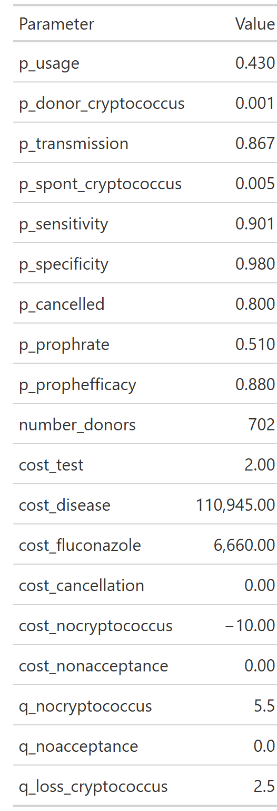
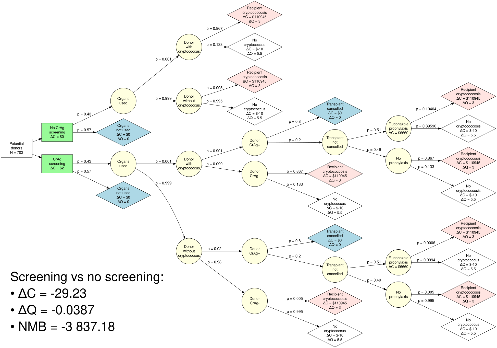
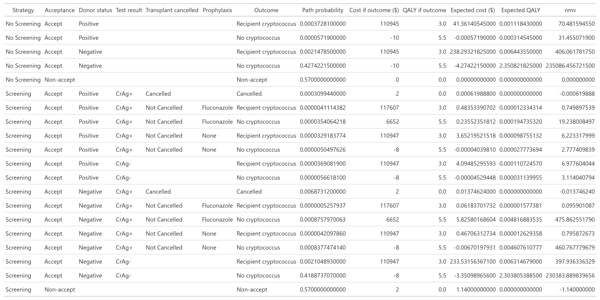
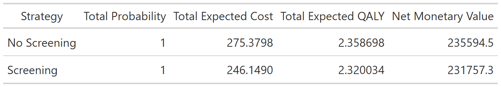

```{r}
#| label: read-base-case
#| include: false
results <- read.csv("../output/base_case_results.csv")
paths <- read.csv("../output/base_case_path_table.csv", na.strings = "NA")

dC <- results$cost_difference
dQ <- results$qaly_difference
nmb <- results$nmb

knitr::read_chunk("../R/setup.R")
```

```{r}
#| label: expected-values
#| include: false
```

```{r}
#| label: simulation-settings
#| include: false
```

```{r}
#| label: base-case-helpers
#| include: false
money <- function(x, accuracy = 0.01) {
  paste0(if (x < 0) "\u2212" else "", "$", formatC(abs(x), format = "f", digits = max(0, -log10(accuracy)), big.mark = ","))
}
qaly <- function(x, digits = 4) paste0(if (x < 0) "\u2212" else "", formatC(abs(x), format = "f", digits = digits))
per_1000 <- function(p) formatC(1000 * p, format = "f", digits = 2)

# Expected cost and QALYs by donor group and strategy, from the pathway table
paths$group <- ifelse(is.na(paths$donor_dz_status), "Kidneys not used",
                      ifelse(paths$donor_dz_status == "Positive", "Donor with cryptococcus", "Donor without cryptococcus"))
by_group <- aggregate(cbind(cost_expected, qaly_expected) ~ group + strategy, data = paths, FUN = sum)
screen <- by_group[by_group$strategy == "Screening", ]
no_screen <- by_group[by_group$strategy == "No Screening", ]
contrib <- merge(screen, no_screen, by = "group", suffixes = c("_s", "_ns"))
contrib$dC <- contrib$cost_expected_s - contrib$cost_expected_ns
contrib$dQ <- contrib$qaly_expected_s - contrib$qaly_expected_ns
contrib <- contrib[match(c("Donor without cryptococcus", "Donor with cryptococcus", "Kidneys not used"), contrib$group), ]
get_contrib <- function(g, what) contrib[contrib$group == g, what]

# Clinical events per potential donor
p_of <- function(strategy, ...) {
  keep <- paths$strategy == strategy
  conditions <- list(...)
  for (column in names(conditions)) keep <- keep & !is.na(paths[[column]]) & paths[[column]] == conditions[[column]]
  sum(paths$probability[keep])
}
cases_ns <- p_of("No Screening", outcome = "Recipient cryptococcus")
cases_s <- p_of("Screening", outcome = "Recipient cryptococcus")
cases_prevented <- cases_ns - cases_s
donor_cases_ns <- p_of("No Screening", outcome = "Recipient cryptococcus", donor_dz_status = "Positive")
donor_cases_s <- p_of("Screening", outcome = "Recipient cryptococcus", donor_dz_status = "Positive")
background_cases_ns <- cases_ns - donor_cases_ns
background_cases_s <- cases_s - donor_cases_s
positive_false <- p_of("Screening", donor_dz_status = "Negative", donor_test_result = "CrAg+")
positive_true <- p_of("Screening", donor_dz_status = "Positive", donor_test_result = "CrAg+")
cancel_false <- p_of("Screening", donor_dz_status = "Negative", cancellation = "Cancelled")
cancel_true <- p_of("Screening", donor_dz_status = "Positive", cancellation = "Cancelled")
cancel_total <- cancel_false + cancel_true
proph_false <- p_of("Screening", donor_dz_status = "Negative", proph = "Fluconazole")
```

The code behind these results is on the [Base-case tree](base_case_tree.qmd) page. The [decision model](model_structure.qmd) page explains the tree and its assumptions, and the [primer](cea_primer.qmd) explains the terms used here. All numbers on this page are per potential donor and are read from the output of the most recent model run.

## Model parameters

For the base case, we assign values to the parameters of the model as below:




## Decision tree with parameters

The decision tree model, populated with the parameters above, leads to the following base case decision tree:



## Path table

The decision tree above yields the following path table:




## Summary table

The analysis above yields the following final summary table:



## What the base case shows

At the base-case values, compared with no screening, donor CrAg screening:

-   **`r if (dC < 0) "saves" else "costs"` `r money(abs(dC))` per potential donor** (ΔC = `r money(dC)`),
-   **`r if (dQ < 0) "loses" else "gains"` `r qaly(abs(dQ))` QALYs per potential donor** (ΔQ = `r qaly(dQ)`), and
-   has a **net monetary benefit of `r money(nmb)`** per potential donor at \$`r format(wtp, big.mark = ",", scientific = FALSE)` per QALY.

`r if (dC < 0 && dQ < 0) paste0("This places screening in the lower-left quadrant of the [cost-effectiveness plane](cea_primer.qmd#the-cost-effectiveness-plane): it saves money but costs health. It saves about ", money(dC / dQ, 1), " for every QALY lost, ", if (dC / dQ > wtp) "more" else "less", " than the ", money(wtp, 1), " a QALY is worth at the threshold, so screening is ", if (nmb > 0) "" else "not ", "cost-effective in the base case.") else if (nmb > 0) "Net monetary benefit is positive, so screening is cost-effective in the base case." else "Net monetary benefit is negative, so screening is not cost-effective in the base case."`

Per-donor numbers are small because almost every donor is uninfected and tests negative. Scaled to **1,000 potential donors**, the same expected values mean the following. The model follows one intended recipient per donor (see [known limitations](model_structure.qmd#known-limitations)), so these are counts per donor, not per kidney.

| Per 1,000 potential donors | Without screening | With screening |
|---|---|---|
| Recipients who develop donor-derived cryptococcosis | `r per_1000(donor_cases_ns)` | `r per_1000(donor_cases_s)` |
| Recipients who develop background (not donor-derived) cryptococcosis | `r per_1000(background_cases_ns)` | `r per_1000(background_cases_s)` |
| Transplants cancelled after a positive screen, donor uninfected (false positive) | — | `r per_1000(cancel_false)` |
| Transplants cancelled after a positive screen, donor infected (true positive) | — | `r per_1000(cancel_true)` |
| Recipients of uninfected donors given fluconazole after a false-positive screen | — | `r per_1000(proph_false)` |

Screening prevents about **`r per_1000(donor_cases_ns - donor_cases_s)` cases of donor-derived cryptococcosis per 1,000 potential donors**, but cancels about **`r per_1000(cancel_total)` transplants**, of which `r round(100 * cancel_false / cancel_total)`% are from uninfected donors: about `r round(cancel_total / (donor_cases_ns - donor_cases_s))` cancelled transplants for every donor-derived case prevented. Background cases also fall, by `r per_1000(background_cases_ns - background_cases_s)` per 1,000, but only because fewer transplants take place and because the model assumes fluconazole after a false-positive screen also prevents later background disease.

## Where the difference comes from

The table splits ΔC and ΔQ by the donor's true status. The three rows add up to the totals above.

| Donor group | ΔC per potential donor | ΔQ per potential donor |
|---|---|---|
| Donor without cryptococcus | `r money(get_contrib("Donor without cryptococcus", "dC"))` | `r qaly(get_contrib("Donor without cryptococcus", "dQ"))` |
| Donor with cryptococcus | `r money(get_contrib("Donor with cryptococcus", "dC"))` | `r qaly(get_contrib("Donor with cryptococcus", "dQ"))` |
| Kidneys not used | `r money(get_contrib("Kidneys not used", "dC"))` | `r qaly(get_contrib("Kidneys not used", "dQ"))` |
| **Total** | **`r money(dC)`** | **`r qaly(dQ)`** |

```{r}
#| label: contribution-values
#| include: false
u_dC <- get_contrib("Donor without cryptococcus", "dC")
u_dQ <- get_contrib("Donor without cryptococcus", "dQ")
i_dC <- get_contrib("Donor with cryptococcus", "dC")
i_dQ <- get_contrib("Donor with cryptococcus", "dQ")
n_dC <- get_contrib("Kidneys not used", "dC")
share <- function(part, total) paste0(round(100 * part / total), "%")
tornado <- read.csv("../output/tornado_results.csv")
tornado <- tornado[order(-tornado$range_nmb), ]
top_inputs <- paste0("`", tornado$parameter[1:3], "`", collapse = ", ")
q_with_disease <- expected_value$q_nocryptococcus - expected_value$q_loss_cryptococcus
```

-   **Donors without cryptococcus: ΔQ = `r qaly(u_dQ)` (`r share(u_dQ, dQ)` of the total) and ΔC = `r money(u_dC)`.** With a specificity of `r expected_value$p_specificity` and a donor prevalence of `r expected_value$p_donor_cryptococcus`, false-positive screens outnumber true positives by about `r round(positive_false / positive_true)` to 1. Each false positive leads to a cancelled transplant with probability `p_cancelled` (`r expected_value$p_cancelled`), and the model counts each cancellation as losing the transplant's whole QALY gain (`q_nocryptococcus`, `r expected_value$q_nocryptococcus`). Their cost change is the test and fluconazole, partly offset by background cryptococcosis that does not occur when the transplant is cancelled or, under the model's assumption, when fluconazole is given.
-   **Donors with cryptococcus: ΔC = `r money(i_dC)` and ΔQ = `r qaly(i_dQ)`.** `r if (i_dC < 0) "This is where the cost saving comes from: screening prevents donor-derived cryptococcosis, and each case avoided saves its cost (" else "Screening adds cost here despite preventing donor-derived cryptococcosis, each case of which costs ("` `cost_disease`, `r money(expected_value$cost_disease, 1)`). `r if (i_dQ < 0) paste0("Even among infected donors, screening loses QALYs. In the model, a transplant complicated by cryptococcosis is still worth ", q_with_disease, " QALYs, more than the 0 QALYs of no transplant, so cancelling a kidney from an infected donor gives up more than the disease would have cost.") else "Among infected donors screening gains QALYs, because the disease it prevents outweighs the transplants it cancels."`
-   **Donors whose kidneys are not used: ΔC = `r money(n_dC)`,** the cost of testing donors whose kidneys would not have been transplanted anyway.

## How much to trust these numbers

The base case uses single best estimates, several of which have weak evidence behind them (see the [evidence review](../references/literature-review.md)). Two structural assumptions matter most for this result:

-   **A cancelled transplant is treated as no transplant at all.** If the intended recipient is usually transplanted later from another donor, the QALY loss from each false positive is much smaller than the model assumes. See [known limitations](model_structure.qmd#known-limitations).
-   **A few inputs drive the result.** In the [one-way sensitivity analysis](results_tornado.qmd), the inputs that move net monetary benefit the most are `r top_inputs`. The [scenario analyses](results_scenarios.qmd) show what happens if positive screens rarely lead to cancellation.

## Other results

-   [**Additional tree analyses**](results_scenarios.qmd): alternative clinical assumptions\
-   [**One-way sensitivity analysis**](results_tornado.qmd): key drivers of results\
-   [**Probabilistic sensitivity analyses**](results_psa.qmd): uncertainty and robustness\
-   [**About**](about.qmd): methods, assumptions, and disclosures
