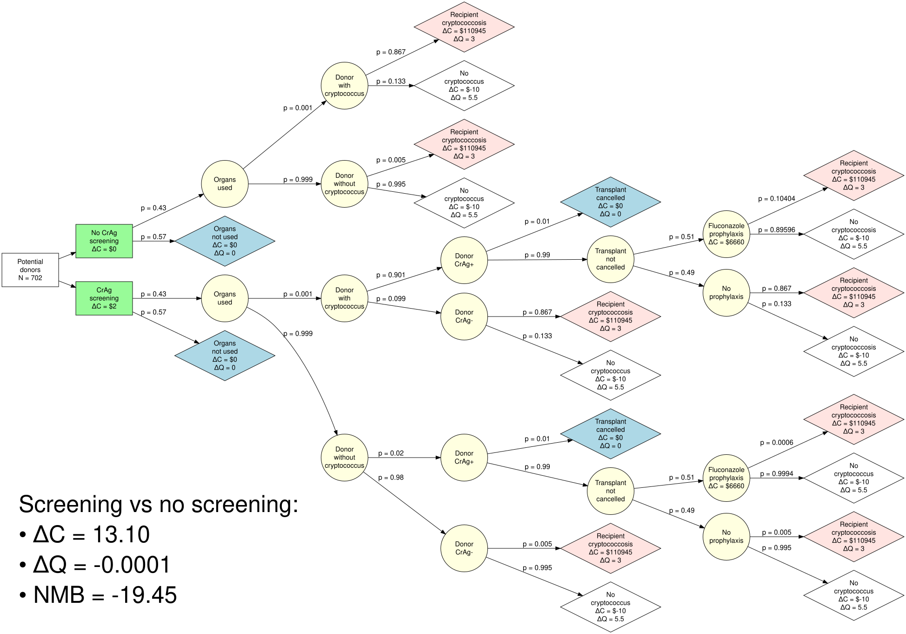
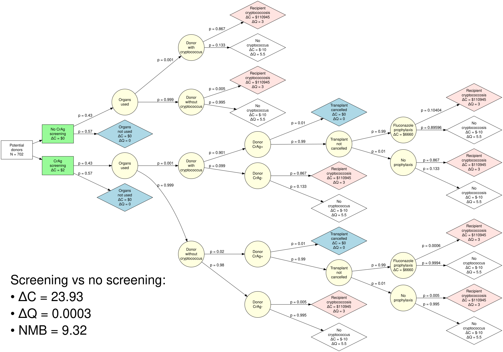
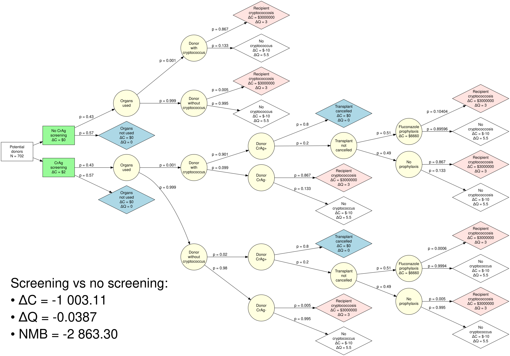
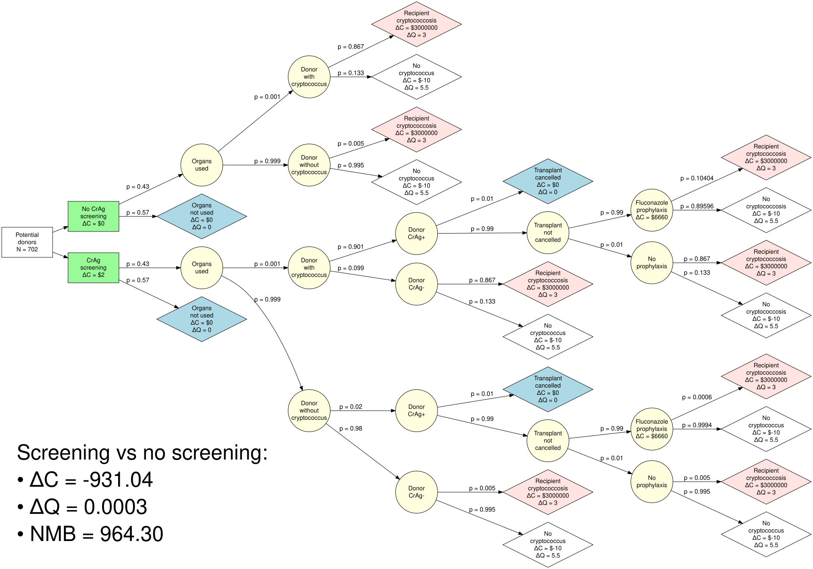

```{r}
#| label: read-setup
#| include: false
#| cache: false
knitr::read_chunk("../R/setup.R")
```

```{r}
#| label: expected-values
#| include: false
```

```{r}
#| label: simulation-settings
#| include: false
```

```{r}
#| label: read-scenarios
#| include: false
scenarios <- read.csv("../output/scenario_results.csv")
base <- read.csv("../output/base_case_results.csv")
money <- function(x, accuracy = 0.01) {
  paste0(if (x < 0) "\u2212" else "", "$", formatC(abs(x), format = "f", digits = max(0, -log10(accuracy)), big.mark = ","))
}
qaly <- function(x, digits = 4) paste0(if (x < 0) "\u2212" else "", formatC(abs(x), format = "f", digits = digits))
yes_no <- function(x) if (x > 0) "Yes" else "No"
share_text <- function(x) paste0(round(100 * x, 1), "%")
s <- function(i, column) scenarios[scenarios$scenario == i, column]
```

The code behind these results is on the [Scenario trees](scenario_trees.qmd) page. Each scenario reruns the [decision model](model_structure.qmd) with one or more inputs changed and every other input at its base-case value; [Sensitivity analyses explained](uncertainty_methods.qmd#scenario-analyses) describes the approach. All numbers are per potential donor and are read from the output of the most recent model run.

## The scenarios side by side

| | Inputs changed | ΔC | ΔQ | NMB | Cost-effective at \$`r format(wtp, big.mark = ",", scientific = FALSE)`/QALY? |
|---|---|---|---|---|---|
| Base case | none | `r money(base$cost_difference)` | `r qaly(base$qaly_difference)` | `r money(base$nmb)` | `r yes_no(base$nmb)` |
| Scenario 1 | `r s(1, "description")` | `r money(s(1, "cost_difference"))` | `r qaly(s(1, "qaly_difference"))` | `r money(s(1, "nmb"))` | `r yes_no(s(1, "nmb"))` |
| Scenario 2 | `r s(2, "description")` | `r money(s(2, "cost_difference"))` | `r qaly(s(2, "qaly_difference"))` | `r money(s(2, "nmb"))` | `r yes_no(s(2, "nmb"))` |
| Scenario 3 | `r s(3, "description")` | `r money(s(3, "cost_difference"))` | `r qaly(s(3, "qaly_difference"))` | `r money(s(3, "nmb"))` | `r yes_no(s(3, "nmb"))` |
| Scenario 4 | `r s(4, "description")` | `r money(s(4, "cost_difference"))` | `r qaly(s(4, "qaly_difference"))` | `r money(s(4, "nmb"))` | `r yes_no(s(4, "nmb"))` |

What the comparison shows:

-   **Making cancellation rare (scenario 1)** changes ΔQ from `r qaly(base$qaly_difference)` to `r qaly(s(1, "qaly_difference"))` QALYs per potential donor: lowering `p_cancelled` from `r expected_value$p_cancelled` to 0.01 removes `r share_text(1 - s(1, "qaly_difference") / base$qaly_difference)` of the base-case QALY loss, which comes almost entirely from transplants cancelled after positive screens. Net monetary benefit is `r money(s(1, "nmb"))`.
-   **Adding near-universal prophylaxis (scenario 2)** gives ΔQ = `r qaly(s(2, "qaly_difference"))`, `r if (s(2, "qaly_difference") > 0) "a small net gain in health" else "still a net loss of health"`, with ΔC = `r money(s(2, "cost_difference"))` and net monetary benefit of `r money(s(2, "nmb"))` per potential donor, `r if (s(2, "nmb") > 0) "so screening is cost-effective, though only narrowly" else "so screening is still not cost-effective"`.
-   **A much higher cost of disease alone (scenario 3).** Raising `cost_disease` to \$3,000,000 leaves ΔQ unchanged at `r qaly(s(3, "qaly_difference"))` and changes ΔC to `r money(s(3, "cost_difference"))` per potential donor. Net monetary benefit is `r money(s(3, "nmb"))`, `r if (s(3, "nmb") > 0) "so the higher cost of disease is enough to make screening cost-effective" else "so even at this cost of disease, the money saved does not make up for the QALYs lost to cancellations"`.
-   **All three changes together (scenario 4).** Screening `r if (s(4, "cost_difference") < 0) "saves money" else "costs money"` and `r if (s(4, "qaly_difference") > 0) "gains health" else "loses health"`, with net monetary benefit of `r money(s(4, "nmb"))`.

The sections below show the annotated tree for each scenario.

## Alternative case #1

Does the near-elimination of organ wastage (`p_cancelled`=0.01) affect the results of the base case?


We see that this improves the NMB associated with screening but does not make screening the preferred strategy.


## Alternative case #2

Does the near-elimination of organ wastage (`p_cancelled`=0.01) **and** near-universal prophylaxis (`p_prophrate`=0.99) affect the results of the base case?



`r if (s(2, "cost_difference") > 0) "While screening is no longer cost-saving in this scenario, " else "Screening still saves money in this scenario, and "``r if (s(2, "nmb") > 0) "NMB is now expected to be positive, suggesting some benefit of screening." else "NMB remains negative."` `r if (s(2, "cost_difference") > 0 && base$cost_difference < 0) paste0("Most of the change in cost comes from cancelling fewer transplants (scenario 1 alone moves \u0394C from ", money(base$cost_difference), " to ", money(s(1, "cost_difference")), "); near-universal fluconazole adds a further ", money(s(2, "cost_difference") - s(1, "cost_difference")), " per potential donor.") else ""`

## Alternative case #3

If the cost of cryptococcus is dramatically higher (`cost_disease`=3000000), does this affect our conclusions?



In this setting, the effects of organ wastage still appear to win out over the costs of disease.


## Alternative case #4

IF we set the cost of cryptococcal disease markedly higher (`cost_disease`=3000000) while also assuming the near-elimination of organ wastage (`p_cancelled`=0.01) **and** near-universal prophylaxis (`p_prophrate`=0.99), what do we conclude?



`r if (s(4, "nmb") > 0) paste0("Screening is cost-effective under these circumstances (NMB ", money(s(4, "nmb")), " per potential donor), but its health gain is very small (\u0394Q = ", qaly(s(4, "qaly_difference")), "), and the result depends on the assumed $3,000,000 cost of each case of cryptococcosis.") else paste0("Even under these circumstances screening is not cost-effective (NMB ", money(s(4, "nmb")), " per potential donor).")`


## Other results

-   [**Base case analysis**](results_base_case.qmd): primary results and interpretation\
-   [**One-way sensitivity analysis**](results_tornado.qmd): key drivers of results\
-   [**Probabilistic sensitivity analyses**](results_psa.qmd): uncertainty and robustness\
-   [**About**](about.qmd): methods, assumptions, and disclosures

