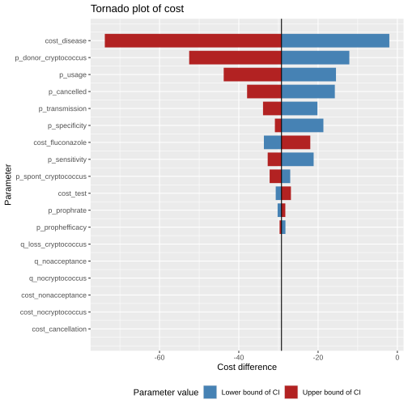
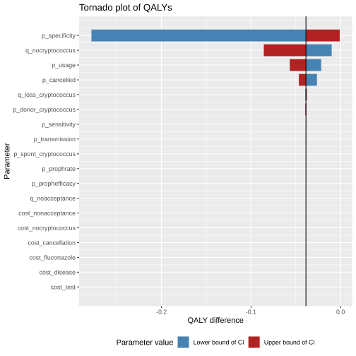

```{r}
#| label: read-scripts
#| include: false
#| cache: false
knitr::read_chunk("../R/sensitivity_analyses.R")
```

## What is a tornado diagram?

A **tornado diagram** is a graphical summary of a [**one-way sensitivity analysis**](https://clas.ucdenver.edu/marcelo-perraillon/sites/default/files/attached-files/lecture_13_uncertainty.pdf), which examines how sensitive the results of a cost-effectiveness model are to changes in individual input parameters.

In a one-way sensitivity analysis, **one parameter is varied at a time** across a plausible range (for example, its 95% confidence interval), while **all other parameters are held constant at their base-case values**. The effect of this variation on the outcome of interest—such as costs or QALYs, is then calculated.

Each horizontal bar in a tornado diagram represents a **single model parameter**. The length of the bar shows how much the outcome changes when that parameter is varied across its specified range.

-   **Longer bars** indicate parameters that have a **greater influence** on the model results\
-   **Shorter bars** indicate parameters with relatively little impact\
-   Parameters are ordered from top to bottom by their impact, creating the characteristic “tornado” shape

The center line represents the **base-case estimate**. The left and right ends of each bar correspond to the **low** and **high** values of the parameter, respectively.

::: Rcode
### Source code

The one-way sensitivity analysis shown on this page is implemented in:

-   [`R/sensitivity_analyses.R`](https://github.com/VagishHemmige/Cryptococcus-donor-screening-CEA/blob/master/R/sensitivity_analyses.R)

This script defines parameter distributions and computes expected costs and QALYs while varying one parameter at a time.

The code sections below are imported directly from that script when this page is rendered.
:::

## Parameters of the model

The parameters are the same as for the [probabilistic sensitivity analysis](psa.qmd#parameters-of-the-model). We utilize the means, and vary the parameters according to the 95% intervals in the appropriate tables.

## Tornado diagrams

### Tornado diagram for costs



We see that costs are most sensitive to assumptions regarding the cost of an episode of cryptococcal disease post-transplant, `cost_disease`, and the probability that a donor has cryptococcus, `p_donor_cryptococcus`.

The expected cost savings from screening, as predicted, increase (become more negative) if those parameters lie at the higher end of the 95% interval.

### Tornado diagram for QALYs



We see that QALYs are most sensitive to assumptions regarding the specificity of cryptococcal screening, `p_specificity`, due to the base case assuming that most donors with cryptococcus will lead to transplant cancellation.

As predicted, higher values of specificity will lead to less QALY loss from screening. Probability of donor cryptococcus, `p_donor_cryptococcus` has surprisingly little effect on QALYs.

## Source code

Click below to open up the source code from [`R/sensitivity_analyses.R`](https://github.com/VagishHemmige/Cryptococcus-donor-screening-CEA/blob/master/R/sensitivity_analyses.R) that is used to perform this analysis.

```{r}
#| label: tornado-analysis
#| eval: false
```

## Other results

-   [**Base case analysis**](base_case.qmd): primary results and interpretation\
-   [**Additional tree analyses**](additional_trees.qmd): alternative clinical assumptions\
-   [**Probabilistic sensitivity analyses**](psa.qmd): uncertainty and robustness\
-   [**About**](about.qmd): methods, assumptions, and disclosures
